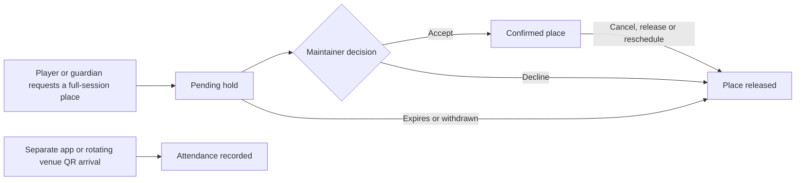

# Supplied application workflows

Both the Leeside website and TT Clubs PWA render the same permission-scoped workspace. The website retains its public club content; the national app selects a club through My Clubs. In synthetic mode, reset/role controls operate only local sample data. Live mode removes those controls, verifies the signed-in account and loads the shared server store. Failed live writes show errors rather than saving fake local records.

## Identity and management

Email/password, registration/verification, email links, recovery and account changes have forms. Google linking needs provider setup; phone codes are optional and off by default. A verified adult can apply as a player or guardian, with linked child profiles and explicit consent. Guests and offline players can be recorded by permitted staff and linked to an account through the audited claim flow. One identity may have distinct roles and memberships in several clubs. A newsletter-only subscription grants no private roster access.

The bootstrapped owner grants individual accounts access to membership, booking, attendance, events, coaching, content, communications, privacy or access management. Grants and revocation are checked on every server command. Unregistered managers currently sign up first; automatic outbound staff invitations remain a refinement. Policy/contact details, website URL, membership catalogue and club settings can change after deployment.

## Memberships and communications

Managers create/edit/retire membership types, set individual start/end dates and record manual payments/corrections. Historical assignments retain their snapshots. Optional acknowledgement selection queues an informal receipt. There is no payment gateway. Trials default to a calendar month and can be extended/configured.

Expiry is inclusive of the selected Ireland calendar day. Scheduled processing queues player/guardian email and a management summary after that day ends, suppressing obsolete renewal messages. Optional 3/10-day reminders and attendance digests are off by default. In-app work/messages exist immediately; email needs the sender/provider and scheduler configuration in the launch guide. Missing credentials leave delivery pending.

## Sessions, tables and attendance

Maintainers publish dated sessions or repeated occurrences/camps, specify table resources and mark each reservable, coaching, walk-in or closed. Overlapping use of the same table is refused. A hall closure cancels affected reservations and reopening does not silently restore them.

There are at most four player places per table and one active place per player/session. Parents can request separate places for linked children. Staff can move/release a place or reschedule atomically to another available session. Attendance never follows automatically from a reservation.

During the session, self/guardian check-in requires explicit physical-presence confirmation. Staff can mark/correct attendance. QR challenges rotate and expire; scanning is a convenience rather than proof of geographic presence. Not attending can be submitted from home and stays separate. Expired/no-membership visits still count and create membership follow-up. Reports offer date ranges, daily/weekly/monthly counts, membership status snapshots, top attendees and exports; visits/capacity is not a simultaneous room-occupancy measure. NFC/card kiosks and offline device queues are parked.

## Matches, tournaments and coaching

Players/staff record singles or doubles, including guests, drafts and incomplete matches. Completed games enforce score/deuce rules; incomplete matches do not count in win statistics. Same-club opponents review results; five days without action permits autoapproval. Edit requests stay disputed until resolved; coaches can intervene. Correcting an earlier knockout result invalidates dependent results rather than preserving an incorrect bracket.

Coaches/admins or delegates create leagues/knockouts, choose today's attendees, explicitly check in another present participant, arrange draft teams/seeding and configure league points/tie-breaks. Byes/progression are supported. External events link results without requiring an unknown external opponent's approval. Duplicate fixture warnings require reuse or an explicit repeat reason.

Players/guardians can privately record strengths/improvement tags and notes against matches/events. Coaches filter grouped counts by event/date/players or selected group/team and drill into contributing observations. Reporting denominators make missing observations visible. These are descriptive reports, not generated skill diagnoses or internal ratings. Coaches retain private notes and separately publish goals/development summaries after distinct coach and family sign-off.

## Public content, privacy and operations

Content managers publish/edit/unpublish plain-text pages/events. Public JSON/RSS/calendar projections exclude private member data; event links return into the appropriate app context. Historical Wix articles/media/documents remain partially source-linked. A new publication does not automatically post to Facebook; RSS readers or separately configured automation are needed.

Shared work supports claim/assignment/comments/resolution, with category permissions. Own-data exports, correction/erasure requests and privacy-manager review are implemented. Restricted coach records require human review before disclosure. Audit records preserve attributed changes. Automatic retention stays disabled until policy/contact details and explicit management approval exist; operational, financial and old private-note rules have source, while remaining retention classes and storage/backup expiry need decisions.

## Remaining launch work

Use [PERSONAL_LAPTOP_LAUNCH.md](PERSONAL_LAPTOP_LAUNCH.md) for commands, [OpenSpec status](../openspec/changes/launch-cork-club-platform/implementation-status.md) for verification evidence and [tasks](../openspec/changes/launch-cork-club-platform/tasks.md) for the complete ledger. Remaining source refinements include persistent recurrence-definition editing, alternate-contact preferences, unregistered staff invitations, advanced post-start tournament changes and full Wix archive/media import. Native store apps follow the PWA pilot. Provider accounts, policies, backups/restore and hosted cross-device tests are owner launch gates; local tests do not establish production readiness.
