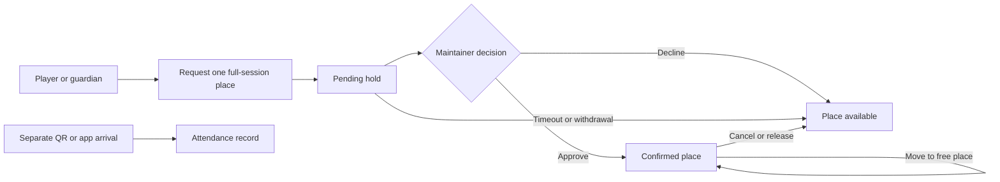

# Implementation and deployment status

Updated 9 November 2026. Requirements describe the target product; this file and `tasks.md` describe what exists. A schema or synthetic screen does not complete a production feature.

Latest source delivery: the shared operational workspace, authenticated command API, versioned private pilot store, scheduler/email source, public feeds and personal-laptop helpers are implemented. See [runtime-design.md](runtime-design.md) for the architecture and [the owner launch guide](../../../docs/PERSONAL_LAPTOP_LAUNCH.md) for complete commands. The older standalone booking preview below is historical. Live mode remains disabled until owner setup; local code completion is distinct from hosted acceptance.

## Verification extension — 9 November 2026

The owner requested stronger unit/integration tests and minimal work on the new laptop. `npm run verify:local` now passes as a single command: all workspace type checks, **80 unit tests** (72 domain + 8 shared live-adapter), **7 isolated setup-helper tests**, both production builds, **3 backend HTTP suites** and automatic desktop/mobile browser workflows against both temporary frontend builds. Browser test servers use ephemeral loopback ports and are cleaned up; existing environment files and deployable assets are preserved by the browser stages. First-use free runtime/browser downloads and Linux OS-library prerequisites are documented in [TESTING.md](../../../docs/TESTING.md).

A separate isolated PostgreSQL 17 integration test also passed locally: **one suite with six steps**, using the actual API/domain commands and SQL commit guards, with explicit local Auth/PostgREST adapters. It verifies competing same-place requests, idempotent retry, cross-channel approval visibility, permission revocation, unrelated/wrong club isolation and database read/duplicate-place denial. SQL permission tests and the generated migration bundle applied twice also passed. Hosted Supabase was not contacted. The extended CI includes all these layers and repeated migration/bootstrap checks; its run result is recorded after the push.

Two handover fixes accompany these tests: generated server settings now include both localhost and 127.0.0.1 on ports 4173/4174, and bootstrap rejects noncanonical owner UUIDs. Existing private files remain preserved; owners with older files must add missing exact origins before uploading secrets. The shared client uses the standard Vite environment API so adapter tests reliably exercise explicit live/synthetic activation. No new cloud account, local database or paid coding-agent subscription is required for the local verification command.

## Supabase handover: office laptop blocked

The owner confirms that Supabase database connections are blocked from their office laptop. The observed CLI failure is a timeout connecting to the hosted PostgreSQL pooler while initializing a temporary login role. This is an environment/connectivity blocker, not evidence that the project, frontend build or migration SQL is defective. No firewall bypass or office-network change is part of this work.

The hosted project already exists: organization **TT Clubs Ireland**, project **ttclubs**, reference **mkxqrkqwpvjtkjfjjckm**, region **eu-north-1 (Stockholm)**. Hosted migration application and further connection setup remain paused. The owner will complete the connection setup from their personal laptop after repository updates are available. Never record database passwords, access tokens or service-role keys in OpenSpec, source code or build output.

Supabase is the proposed shared authentication, PostgreSQL and authorization service. It is needed for verified player/parent accounts, guardian relationships, current club permissions, persistent memberships, attendance, shared table availability, concurrent booking protection, match/tournament records and notification scheduling. Email transport also requires a configured delivery provider; creating Supabase alone does not send the application's reminders.

Cloudflare serves frontend assets independently. Synthetic mode does not synchronize devices or provide real authentication; live-mode source now uses the shared command API/store and current server permissions. The old normalized QR RPCs remain legacy source; the new portal has its own canonical QR command flow. No hosted migration or live backend test has been performed.

### Personal-laptop handover sequence

1. Pull the latest `main`, select Node 22 and install dependencies with `npm ci`. Use synthetic test records only.
2. Sign into the Supabase CLI with the owner's account and link project `mkxqrkqwpvjtkjfjjckm`. Do not create a duplicate project or reset the hosted database.
3. From a permitted personal connection, run `npx supabase db push --remote --dry-run`. The previously installed CLI requires `--remote` to target the linked project. Check `--help` if the installed CLI changes; never assume a local reset command is safe for hosted use.
4. Review the proposed migration list and database/schema state before running `npx supabase db push --remote`. Apply repository migrations only; `supabase/tests/plain_postgres_auth_fixture.sql` is a local CI fixture, not a hosted migration. If the pooler still times out, stop and diagnose connectivity separately rather than retrying writes blindly.
5. Configure environment variables privately, exact Auth site/redirect URLs, and synthetic users, profiles, club permissions and guardian relationships. The earlier local frontend configuration may not exist on the personal laptop.
6. Follow the launch guide to deploy functions, bootstrap the owner, set exact origins/callbacks and deploy both frontends. Complete the listed smoke tests and email/backup configuration before real member/child import. No additional application coding is required to exercise the supplied core workflows; any remaining advanced product gaps remain explicitly listed in tasks.md.

## Capability reconciliation

| Capability | Repository delivery | Remaining implementation / live acceptance |
| --- | --- | --- |
| Identity and access | Email/password, signup/verification, recovery, magic links, Google linking, optional phone code/linking; current grants/guardians; audited offline-profile claim; My Clubs directory | Provider/redirect configuration and hosted acceptance; SMS remains off by default |
| Club content | Source-backed sections and Wix links; editable plain-text publishing and safe public JSON/RSS/calendar source | Historical Wix media/documents/archive import; hosted public-content acceptance |
| Membership management | Runtime catalogue/retirement, manual periods and additional payment corrections, optional receipts, trials/extensions and consent | Hosted permissions, mail and real-data acceptance |
| Booking management | Shared portal/commands; four-place/full-session rules, guardian requests, holds/approval/moves/releases; specific table resources, programme publishing and hall closures; SQL uniqueness/CAS guards | Hosted concurrency/cross-device tests, load/egress acceptance and production configuration |
| Member communications | In-app queue, recipient/renewal/guardian checks, expiry/trial/booking/review scheduling, Resend worker with leases/idempotency/retry limits and global budget | Sender/domain/API credentials, Auth SMTP, cron/Vault configuration and actual delivery tests |
| Attendance tracking | Direct app/rotating QR, guardian selection, explicit presence, Not attending, membership follow-up, corrections, ranged reports and exports | Real-device/hosted acceptance; NFC/kiosk hardware is parked |
| Match records | Singles/doubles/guests, game validation, drafts/incomplete, opponent/coach review, five-day inaction job, duplicate warning/fixture reuse | Hosted review/deadline acceptance; corrections invalidate dependent played results for explicit resolution |
| Tournament management | Internal leagues/knockouts, editable draft teams/seeding, points/tie-breaks/byes/progression, delegation/check-in; external events and private proposals | Advanced post-start structure changes and broader load/acceptance cases remain tracked |
| Tournament reflections | Participant/guardian private tags/notes/revisions, external reported provenance, event/date grouped coaching counts | Hosted privacy acceptance; selected-player/group/team filters and matching drill-down exist |
| Player development | Restricted coach notes, assessments/goals and distinct coach/family sign-off | Hosted visibility/acceptance and retention purpose review |
| Club administration | Runtime scoped grants, shared work, policy editing, permitted exports, audit and approved retention source | Full governance/retention decisions, encrypted off-site backup/restore and operational monitoring |
| Deployment and handover | Fresh CLI login/link, environment, migration bundle, function staging/deploy, owner bootstrap, schedule and independent app Worker config | Owner performs account-required commands and live checks from personal laptop |

## Shared session booking flow

Synthetic mode runs these transitions locally. Live-mode source applies the same rules through the authorized command API with database revision/uniqueness checks, independent attendance and queued notifications. Hosted behavior still requires owner deployment and acceptance.

The supplied `Leeside Table Booking.html` is a design reference, not a Claude runtime dependency. `ClubPortal.tsx` now replaces the standalone `SessionBookingDemo.tsx` in both entry points. Shared booking rules remain in `session-booking.ts` and the broader command service is `operations.ts`.

The approved unit is **one player place for a whole session**, with **four places per table** and **one active pending/confirmed place per player per session**. Parents can request separate places for linked children. Preview roles support request, approve/decline, cancellation, staff moves/releases and per-session reservable/coaching/walk-in/closed allocations. Attendance remains independent. Staff can explicitly release a no-show's place; no automatic no-show detection is claimed.

Synthetic people/tables are demonstration defaults, not confirmed physical inventory. The real bootstrap starts empty; managers configure sessions/tables, holds/cancellation and membership policy using the supplied forms. The earlier hourly whole-table model is superseded. The old normalized `bookings` table is not the active command-store inventory.

## Local verification — 7 November 2026

- `npm run check`: all workspace type checks, **72 domain tests across four files**, both production builds and PWA generation passed on Node 22. Tests cover booking/permission/guardian/idempotency/privacy, bracket corrections, email suppression and audit behavior.
- Prepared canonical function-local rules, then Deno checked all three handlers; **three local HTTP integration tests** passed for authenticated API, scheduler/provider-budget behavior and public feed privacy. Fake local services/provider interception were used; no real email was sent.
- Fresh isolated PostgreSQL 17: all three migrations applied through the generated SQL-Editor bundle; `runtime.sql` and legacy `venue_qr.sql` passed. Reapplying the migration bundle and fake-owner bootstrap preserved existing data. No hosted database was contacted. The installed CLI help confirms multi-function deployment with `--use-api` (HTTP bundling, no Docker).
- Synthetic Chromium desktop/mobile walkthrough passed against **both website and national app entry points** catalogue creation, guardian booking, maintainer approval, attendance/report, scoring, reflection privacy, opponent review and coach aggregation; 390px and 320px checks found no horizontal overflow.
- Frontend environment checks rejected a fake server key and an unexpected VITE variable. OpenSpec validation and `git diff --check` passed.
- Dependency audit after compatible updates: **0 high/critical**, **4 moderate and 2 low** in the PWA/Workbox build dependency chain. These remain a tracked release review, not a clean-audit claim. No disruptive forced major upgrade was applied.

Edge CI now selects `supabase/functions/deno.json` explicitly with automatic npm dependency resolution, avoiding a dependency on preinstalled frontend node_modules. All handlers also type-checked in a clean temporary tree; local HTTP tests passed with that standalone config. The initial main build/database CI jobs passed while Edge CI failed; the standalone dependency fix is pushed in **0988b32**. [GitHub Quality run 42427039296](https://github.com/tamil07/table-tennis-ireland/actions/runs/42427039296) passed all three jobs: check, edge-functions and venue-qr-database. GitHub denied the earlier full-log download, so no unobserved error text is asserted.

These are local/synthetic checks, not actual Supabase configuration, native Safari/Android testing, distributed load acceptance, backup restoration or production email verification.

## Source delivery and public deployment

Implementation commit **`2577059`** is pushed to `main`. The Cloudflare website serves its new synthetic operational portal at https://table-tennis-ireland.ttclubsie.workers.dev. All four served asset hashes match the local production build exactly; root/assets and SPA fallback checks passed. The same browser workflow passed on the deployed website, using fake browser-local data only. This is **not** hosted backend acceptance. The separate app Worker still awaits owner deployment.

## Release gates and deferred scope

Historical standalone-preview delivery `ef10b50` is pushed to main. The website deployment was verified using matching JS/CSS hashes, SPA response and a live mobile synthetic request/approval walkthrough. Local checks passed 21 tests, all workspace type checks, both builds and OpenSpec validation. See `docs/CLOUDFLARE_DEPLOYMENT_PLAN.md` for asset evidence. This verifies the preview, not the remaining live product.

Hosted setup is one dependency, not the only remaining work. Production requires tested RLS/permissions, shared transactional services, authenticated email delivery, backups/restoration, safeguarding/privacy configuration and end-to-end acceptance. Do not advertise real bookings or import private live records into a synthetic demo.

For another coding agent, root `AGENTS.md` provides the required reading order, approved decisions, code locations, ordered implementation streams, test/deployment commands and reporting rules. It links this status record rather than maintaining an unrelated competing task list. Public website copy identifies the preview; infrastructure credentials and developer task details belong in repository documentation, not visitor account flows.

NFC hardware purchases and broad pilot recruitment stay parked. Native iOS/Android store releases follow the PWA pilot. Website repository extraction is reviewed only after at least one live year and three or more clubs. See `tasks.md` for the full outstanding implementation checklist and `docs/ACCOUNT_SETUP_README.md` for owner account actions.
