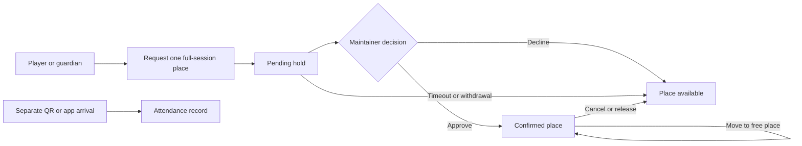

# Implementation and deployment status

Updated 16 November 2026. Requirements describe the target product; this file and `tasks.md` describe what exists. A schema or synthetic screen does not complete a production feature.

## Website presentation and management usability — 17 November 2026

Requested by the owner: a more current public website and easier club management. Requirements: `specs/club-content` (modern, honest public presentation) and `specs/club-administration` (usable management workspace). Tasks: section 16. Full technical description, source map, anchors, tokens and extension notes: the "Presentation layer" section of `design.md`.

**Implemented in source (not deployed by this agent)**
- Public website (`apps/club-web`): sticky header with keyboard-operable mobile menu (previously hidden below 760px), skip link, hero with a live next-session card, ticker, bento tiles, timetable with a Today marker, source-attributed price cards, FAQ, light/dark colour schemes, reduced-motion handling, Open Graph metadata and JSON-LD built only from confirmed facts. No testimonials, photographs, counts or news were invented; missing Wix material remains honest source links.
- Management workspace (`packages/ui`): permission-aware Overview landing tab (default; deep link `#club=<id>&view=overview`), desktop sidebar / mobile scrolling navigation, design-token restyle (`--ops-*`), people search, empty states and setup hints. All existing tab names and form labels are unchanged. The workspace is shared, so the national app gets the same improvement.
- New pure helpers `nextWeeklySession` and `clubOverview` in `packages/domain/src/presentation.ts` with 9 unit tests (Dublin summer/winter time, in-progress session, Sunday-to-Monday wrap, unparseable times, permission gating, empty-club setup hints).
- No change to command rules, permissions, booking behaviour, stored data, Edge Functions or SQL. **No migration and no `deploy:backend` are needed for this work.**

**Verified locally on Node 22 (17 November 2026)**: all type checks; **109 unit tests** (101 domain including the 9 new, plus 8 adapter); **12 setup/helper tests**; both frontend builds; backend HTTP suites; and the full `npm run verify:local` browser workflows on **both** website and PWA, extended with Overview, people search and the website mobile menu at 390px, plus the existing 390/320px no-horizontal-scroll check. `openspec validate launch-cork-club-platform` passed. Screenshots of light, dark and mobile website views and the Overview tab were inspected by the agent during development. These checks did not authenticate to or change hosted accounts.

**Environment note**: use Node 22 (`.nvmrc`). Under Node 20.19 the setup tests fail with `ERR_UNKNOWN_FILE_EXTENSION` for `.ts`, which looks like a regression but is only the wrong runtime. The OpenSpec CLI ran fine through `npx --yes openspec validate` using the default Node.

**Owner steps on the personal laptop (task 16.8)**
1. Follow `docs/START_HERE.md` (Node 22, pull, `npm ci`); do not repeat bootstrap or migrations.
2. `npm run verify:local`, then `npm run deploy:club` (website) and `npm run deploy:platform` (app, for the shared workspace changes). Backend is unchanged by this work; deploy it only for the separate 16 November membership correction (task 15.8).
3. Cloudflare Git builds need the four `VITE_*` public variables set separately (task 14.4); a push alone is not deployment evidence, so check the served asset hash.
4. Review on a real phone and desktop, in light and dark mode: mobile menu, next-session card, timetable Today marker, price cards, FAQ, and the Overview tab after signing in as the owner (an empty new club should show the setup hints).
5. Record the outcome in `docs/DEPLOYMENT_STATUS.md`.

**Still open**: real photography, logo and imported news depend on source material (task 4.7); ticker pause control and a formal accessibility/contrast audit (16.9); the behaviour-neutral split of the roughly 3,200-line `ClubPortal.tsx` is deliberately deferred (16.7).

## Player and membership correction — 16 November 2026

The owner encountered a creation problem; exact screen/error confirmation remains open. Independent reproduction found the required guardian selector blocked adult player saves, the combined correction/renewal action replaced the existing period, and correction re-snapshotted edited catalogue terms. Source now shows guardians only for juniors, isolates each editor with explicit new/cancel/reset behavior, appends renewals using the existing membership command and preserves unchanged-type snapshots including retired types. Unpaid zero receipts no longer require a fictional received date. Active-period overlap, missing edit targets, repeat trials and duplicate identifiers are refused. Reactivation clears departure metadata; private-note retention also requires actual departed status.

Guardian access now requires a junior target and a non-departed adult guardian. Linked accounts/owners/responsible guardians cannot be reclassified as juniors through ordinary edits. Optional JSON account/trial/renewal fields need no SQL migration. The live profile-claim service verifies current Auth source/target ownership, refuses lookup failures and independently authenticated sources (including legacy phone-only accounts), and preserves retry behavior. No hosted setup or account change was performed. Owner backend/frontend deployment and authenticated acceptance remain required, separately from source tests. See [MEMBERSHIP_WORKFLOW.md](../../../docs/MEMBERSHIP_WORKFLOW.md) and tasks section 15; the duration-based catalogue still does not implement per-visit entitlements.

Local verification passed: all type checks, **100 unit tests** (92 domain + 8 adapter), **12 setup/helper tests**, both frontend builds, all three Deno handler checks and **three HTTP suites**. The expanded synthetic browser workflows passed on **both website and PWA**, including adult/junior creation, independent editors, unpaid periods and separate renewal history, alongside existing booking/attendance/match/privacy/mobile checks. An initial browser assertion compared rendered line breaks with DOM text; after fixing that test comparison, both workflows passed. OpenSpec validation and diff whitespace checks passed. These checks did not authenticate to or modify hosted accounts.

Correction **3f6496d** is pushed to `main`; all four [Quality jobs](https://github.com/tamil07/table-tennis-ireland/actions/runs/43892027989), including real PostgreSQL integration, passed. The [Cloudflare automatic website build](https://dash.cloudflare.com/6502a73494f4ee7107b36c620ee76471/workers/services/view/table-tennis-ireland/production/builds/2ab7ed07-ae69-4639-a9bd-b6bb6aeb69a8) also succeeded, superseding the earlier unresolved-build observation for this release; the old cause remains unknown. Anonymous website HTTP 200 and asset `index-CrbDP0_x.js` confirm the new renewal/junior-guardian UI is served. The app remains HTTP 200 on its older asset `index-Cb3vBNfk.js`, without these changes. Backend source was not deployed or privately tested by this agent. Owner `deploy:backend` and `deploy:platform` updates remain required, particularly for the new empty-payment-date and account-link rules; do not infer server completion from the automatic website build. See DEPLOYMENT_STATUS for details. The offline doctor reported zero failures/four local configuration warnings without provider changes.

Latest source delivery: the shared operational workspace, authenticated command API, versioned private pilot store, scheduler/email source, public feeds and personal-laptop helpers are implemented. See [runtime-design.md](runtime-design.md) for the architecture and [the owner launch guide](../../../docs/PERSONAL_LAPTOP_LAUNCH.md) for complete commands. The older standalone booking preview below is historical. Repository defaults remain synthetic, but both public deployments were observed in live mode on 12 November. Public observations and remaining owner-only verification are recorded below; local completion is distinct from authenticated hosted acceptance.

## Existing-deployment resumption — 12 November 2026

Anonymous checks confirmed HTTP 200 and live-mode sign-in screens at both the Leeside website and national app URLs. Their bundles enable live mode and reference the existing project; the website's ordinary public content request returned HTTP 200. No private sign-in, hosted mutation, email, cron or account change was performed. These observations supersede earlier claims that the app was undeployed or both public sites were still synthetic; they do not close owner acceptance.

At the start of review GitHub had only main at 1258a44 (9 November), with no newer owner commits, despite changed public deployment assets. Private environment files/account changes are not copied by Git. See [DEPLOYMENT_STATUS.md](../../../docs/DEPLOYMENT_STATUS.md) for non-secret outcomes and the remaining owner checklist; use [START_HERE.md](../../../docs/START_HERE.md) on either laptop instead of blindly repeating bootstrap/migration setup.

New source supplies an offline `setup:doctor` inventory, `setup:env -- --frontend-only` to avoid creating/rotating an existing scheduler secret, and production validation/rebuild wrappers. Production build:club/build:platform require explicit live activation, a browser-safe key and the existing pilot project URL; deploy commands rebuild through those guards. A Git build with missing live variables must fail before publication. Local check/build/browser tests retain synthetic operation. This protects the documented scripts; arbitrary custom CLI uploads are not covered.

The expanded setup suite has 12 cases (80 domain/adapter unit tests remain unchanged), covering fail-closed production entry points, wrong-project refusal, frontend-only preservation and doctor output without credentials. Full `npm run verify:local` passed: 80 unit tests, 12 setup regressions, three backend HTTP suites, both production-format local builds and both temporary browser workflows. `setup:doctor` ran without failures and correctly reported missing local maintenance settings; it performed no network/provider action. Commit **483701c** passed all four [Quality jobs](https://github.com/tamil07/table-tennis-ireland/actions/runs/43267222371). Post-push anonymous checks confirmed both public URLs still returned HTTP 200 with live sign-in and no demo picker. The separate Cloudflare automatic build failed ([provider log](https://dash.cloudflare.com/6502a73494f4ee7107b36c620ee76471/workers/services/view/table-tennis-ireland/production/builds/4e0fae3d-b80b-44d8-a719-974df4e6f2ad)); GitHub supplies no error text, so its cause is unverified. Existing live sites remained available. The owner must inspect build variables/commands and the actual log before retrying; this is separate from source/Quality success. Public live availability does not prove private services, sending/SMTP, Vault/cron, Git-build settings or backups have passed acceptance.

## Verification extension — 9 November 2026

The owner requested stronger unit/integration tests and minimal work on the new laptop. `npm run verify:local` now passes as a single command: all workspace type checks, **80 unit tests** (72 domain + 8 shared live-adapter), **8 isolated setup-helper tests**, both production builds, **3 backend HTTP suites** and automatic desktop/mobile browser workflows against both temporary frontend builds. Browser test servers use ephemeral loopback ports and are cleaned up; existing environment files and deployable assets are preserved by the browser stages. First-use free runtime/browser downloads and Linux OS-library prerequisites are documented in [TESTING.md](../../../docs/TESTING.md).

A separate isolated PostgreSQL 17 integration test also passed locally: **one suite with six steps**, using the actual API/domain commands and SQL commit guards, with explicit local Auth/PostgREST adapters. It verifies competing same-place requests, idempotent retry, cross-channel approval visibility, permission revocation, unrelated/wrong club isolation and database read/duplicate-place denial. SQL permission tests and the generated migration bundle applied twice also passed. Hosted Supabase was not contacted. The extended CI includes all these layers and repeated migration/bootstrap checks. Its initial runs passed unit/setup/build, backend and PostgreSQL jobs but the browser launcher missed Vite URLs with coloured port numbers in CI. The parser now strips terminal control sequences, with a dedicated regression test and an explicit CI=true local browser run. Browser assertions also await UI state and emit scoped synthetic failure diagnostics. Corrected commit **fb07828** passed all four jobs in [Quality run 42616047886](https://github.com/tamil07/table-tennis-ireland/actions/runs/42616047886): check, edge-functions, venue-qr-database and browser-workflows.

Two handover fixes accompany these tests: generated server settings now include both localhost and 127.0.0.1 on ports 4173/4174, and bootstrap rejects noncanonical owner UUIDs. Existing private files remain preserved; owners with older files must add missing exact origins before uploading secrets. The shared client uses the standard Vite environment API so adapter tests reliably exercise explicit live/synthetic activation. No new cloud account, local database or paid coding-agent subscription is required for the local verification command.

## Supabase handover: office laptop blocked

The owner confirms that Supabase database connections are blocked from their office laptop. The observed CLI failure is a timeout connecting to the hosted PostgreSQL pooler while initializing a temporary login role. This is an environment/connectivity blocker, not evidence that the project, frontend build or migration SQL is defective. No firewall bypass or office-network change is part of this work.

The hosted project already exists: organization **TT Clubs Ireland**, project **ttclubs**, reference **mkxqrkqwpvjtkjfjjckm**, region **eu-north-1 (Stockholm)**. Office-laptop hosted migration/connection actions remain paused. The owner has progressed public deployment from the personal laptop; migration and private-service outcomes still need confirmation in DEPLOYMENT_STATUS.md. Never record database passwords, access tokens or service-role keys in OpenSpec, source code or build output.

Supabase is the proposed shared authentication, PostgreSQL and authorization service. It is needed for verified player/parent accounts, guardian relationships, current club permissions, persistent memberships, attendance, shared table availability, concurrent booking protection, match/tournament records and notification scheduling. Email transport also requires a configured delivery provider; creating Supabase alone does not send the application's reminders.

Cloudflare serves frontend assets independently. Synthetic mode does not synchronize devices or provide real authentication; live-mode source now uses the shared command API/store and current server permissions. The old normalized QR RPCs remain legacy source; the new portal has its own canonical QR command flow. No hosted migration or private live backend test has been performed by this agent during the office-laptop work; the public reader availability observed above is limited evidence.

### Personal-laptop handover sequence

1. Pull the latest `main`, select Node 22 and install dependencies with `npm ci`. Use synthetic test records only.
2. Sign into the Supabase CLI with the owner's account and link project `mkxqrkqwpvjtkjfjjckm`. Do not create a duplicate project or reset the hosted database.
3. From a permitted personal connection, run `npx supabase db push --remote --dry-run`. The previously installed CLI requires `--remote` to target the linked project. Check `--help` if the installed CLI changes; never assume a local reset command is safe for hosted use.
4. Review the proposed migration list and database/schema state before running `npx supabase db push --remote`. Apply repository migrations only; `supabase/tests/plain_postgres_auth_fixture.sql` is a local CI fixture, not a hosted migration. If the pooler still times out, stop and diagnose connectivity separately rather than retrying writes blindly.
5. Configure environment variables privately, exact Auth site/redirect URLs, and synthetic users, profiles, club permissions and guardian relationships. The earlier local frontend configuration may not exist on the personal laptop.
6. Follow the launch guide to deploy functions, bootstrap the owner, set exact origins/callbacks and deploy both frontends. Complete the listed smoke tests and email/backup configuration before real member/child import. No additional application coding is required to exercise the supplied core workflows; any remaining advanced product gaps remain explicitly listed in tasks.md.

## Capability reconciliation

| Capability | Repository delivery | Remaining implementation / live acceptance |
| --- | --- | --- |
| Identity and access | Email/password, signup/verification, recovery, magic links, Google linking, optional phone code/linking; current grants/guardians; audited offline-profile claim; My Clubs directory | Provider/redirect configuration and hosted acceptance; SMS remains off by default |
| Club content | Source-backed sections and Wix links; editable plain-text publishing and safe public JSON/RSS/calendar source | Historical Wix media/documents/archive import; hosted public-content acceptance |
| Membership management | Runtime catalogue/retirement, manual periods and additional payment corrections, optional receipts, trials/extensions and consent | Hosted permissions, mail and real-data acceptance |
| Booking management | Shared portal/commands; four-place/full-session rules, guardian requests, holds/approval/moves/releases; specific table resources, programme publishing and hall closures; SQL uniqueness/CAS guards | Hosted concurrency/cross-device tests, load/egress acceptance and production configuration |
| Member communications | In-app queue, recipient/renewal/guardian checks, expiry/trial/booking/review scheduling, Resend worker with leases/idempotency/retry limits and global budget | Sender/domain/API credentials, Auth SMTP, cron/Vault configuration and actual delivery tests |
| Attendance tracking | Direct app/rotating QR, guardian selection, explicit presence, Not attending, membership follow-up, corrections, ranged reports and exports | Real-device/hosted acceptance; NFC/kiosk hardware is parked |
| Match records | Singles/doubles/guests, game validation, drafts/incomplete, opponent/coach review, five-day inaction job, duplicate warning/fixture reuse | Hosted review/deadline acceptance; corrections invalidate dependent played results for explicit resolution |
| Tournament management | Internal leagues/knockouts, editable draft teams/seeding, points/tie-breaks/byes/progression, delegation/check-in; external events and private proposals | Advanced post-start structure changes and broader load/acceptance cases remain tracked |
| Tournament reflections | Participant/guardian private tags/notes/revisions, external reported provenance, event/date grouped coaching counts | Hosted privacy acceptance; selected-player/group/team filters and matching drill-down exist |
| Player development | Restricted coach notes, assessments/goals and distinct coach/family sign-off | Hosted visibility/acceptance and retention purpose review |
| Club administration | Runtime scoped grants, shared work, policy editing, permitted exports, audit and approved retention source | Full governance/retention decisions, encrypted off-site backup/restore and operational monitoring |
| Deployment and handover | Fresh CLI login/link, environment, migration bundle, function staging/deploy, owner bootstrap, schedule and independent app Worker config | Owner performs account-required commands and live checks from personal laptop |

## Shared session booking flow

Synthetic mode runs these transitions locally. Live-mode source applies the same rules through the authorized command API with database revision/uniqueness checks, independent attendance and queued notifications. Hosted behavior still requires owner deployment and acceptance.

The supplied `Leeside Table Booking.html` is a design reference, not a Claude runtime dependency. `ClubPortal.tsx` now replaces the standalone `SessionBookingDemo.tsx` in both entry points. Shared booking rules remain in `session-booking.ts` and the broader command service is `operations.ts`.

The approved unit is **one player place for a whole session**, with **four places per table** and **one active pending/confirmed place per player per session**. Parents can request separate places for linked children. Preview roles support request, approve/decline, cancellation, staff moves/releases and per-session reservable/coaching/walk-in/closed allocations. Attendance remains independent. Staff can explicitly release a no-show's place; no automatic no-show detection is claimed.

Synthetic people/tables are demonstration defaults, not confirmed physical inventory. The real bootstrap starts empty; managers configure sessions/tables, holds/cancellation and membership policy using the supplied forms. The earlier hourly whole-table model is superseded. The old normalized `bookings` table is not the active command-store inventory.

## Local verification — 7 November 2026

- `npm run check`: all workspace type checks, **72 domain tests across four files**, both production builds and PWA generation passed on Node 22. Tests cover booking/permission/guardian/idempotency/privacy, bracket corrections, email suppression and audit behavior.
- Prepared canonical function-local rules, then Deno checked all three handlers; **three local HTTP integration tests** passed for authenticated API, scheduler/provider-budget behavior and public feed privacy. Fake local services/provider interception were used; no real email was sent.
- Fresh isolated PostgreSQL 17: all three migrations applied through the generated SQL-Editor bundle; `runtime.sql` and legacy `venue_qr.sql` passed. Reapplying the migration bundle and fake-owner bootstrap preserved existing data. No hosted database was contacted. The installed CLI help confirms multi-function deployment with `--use-api` (HTTP bundling, no Docker).
- Synthetic Chromium desktop/mobile walkthrough passed against **both website and national app entry points** catalogue creation, guardian booking, maintainer approval, attendance/report, scoring, reflection privacy, opponent review and coach aggregation; 390px and 320px checks found no horizontal overflow.
- Frontend environment checks rejected a fake server key and an unexpected VITE variable. OpenSpec validation and `git diff --check` passed.
- Dependency audit after compatible updates: **0 high/critical**, **4 moderate and 2 low** in the PWA/Workbox build dependency chain. These remain a tracked release review, not a clean-audit claim. No disruptive forced major upgrade was applied.

Edge CI now selects `supabase/functions/deno.json` explicitly with automatic npm dependency resolution, avoiding a dependency on preinstalled frontend node_modules. All handlers also type-checked in a clean temporary tree; local HTTP tests passed with that standalone config. The initial main build/database CI jobs passed while Edge CI failed; the standalone dependency fix is pushed in **0988b32**. [GitHub Quality run 42427039296](https://github.com/tamil07/table-tennis-ireland/actions/runs/42427039296) passed all three jobs: check, edge-functions and venue-qr-database. GitHub denied the earlier full-log download, so no unobserved error text is asserted.

These are local/synthetic checks, not actual Supabase configuration, native Safari/Android testing, distributed load acceptance, backup restoration or production email verification.

## Source delivery and public deployment

Implementation commit **`2577059`** is pushed to `main`. The Cloudflare website serves its new synthetic operational portal at https://table-tennis-ireland.ttclubsie.workers.dev. All four served asset hashes match the local production build exactly; root/assets and SPA fallback checks passed. The same browser workflow passed on the deployed website, using fake browser-local data only. This is **not** hosted backend acceptance. The separate app public URL was subsequently observed on 12 November; authenticated acceptance and source-version mapping remain owner checks.

## Release gates and deferred scope

Historical standalone-preview delivery `ef10b50` is pushed to main. The website deployment was verified using matching JS/CSS hashes, SPA response and a live mobile synthetic request/approval walkthrough. Local checks passed 21 tests, all workspace type checks, both builds and OpenSpec validation. See `docs/CLOUDFLARE_DEPLOYMENT_PLAN.md` for asset evidence. This verifies the preview, not the remaining live product.

Hosted setup is one dependency, not the only remaining work. Production requires tested RLS/permissions, shared transactional services, authenticated email delivery, backups/restoration, safeguarding/privacy configuration and end-to-end acceptance. Do not advertise real bookings or import private live records into a synthetic demo.

For another coding agent, root `AGENTS.md` provides the required reading order, approved decisions, code locations, ordered implementation streams, test/deployment commands and reporting rules. It links this status record rather than maintaining an unrelated competing task list. Public website copy identifies the preview; infrastructure credentials and developer task details belong in repository documentation, not visitor account flows.

NFC hardware purchases and broad pilot recruitment stay parked. Native iOS/Android store releases follow the PWA pilot. Website repository extraction is reviewed only after at least one live year and three or more clubs. See `tasks.md` for the full outstanding implementation checklist and `docs/ACCOUNT_SETUP_README.md` for owner account actions.

## Personal-laptop hosted launch — 10 November 2026

Recorded from the owner's personal laptop session. Secrets, tokens, passwords and private environment values are intentionally excluded; they live only in ignored local files or provider secret stores.

Completed against the hosted project `ttclubs` (`mkxqrkqwpvjtkjfjjckm`, eu-north-1, production), each after explicit owner approval:

- **Database:** all three repository migrations applied (`202610030001_initial_platform`, `202610250001_venue_qr`, `202611080001_club_runtime`). Remote migration history matches the local files.
- **Server secrets:** four application secrets set (`APP_URL`, `APP_ORIGINS`, `CLUB_JOB_TOKEN`, `EMAIL_REPLY_TO`). Transactional email provider secrets are not yet set.
- **Backend functions:** `club-api`, `club-jobs` and `club-public` deployed and active. `club-api` validates the bearer token through Supabase Auth; `club-jobs` requires the job token.
- **Owner access:** Supabase Auth user for `leesidettie@gmail.com` created and confirmed by the owner. The Leeside club owner was bootstrapped with that user's ID; the club record (`leeside`, join code `LEESIDE`) is active.
- **Live mode and frontends:** `VITE_ENABLE_LIVE=true` set in both app builds. Website Worker `table-tennis-ireland` and app Worker `ttclubs-app` deployed; both respond HTTP 200 at their workers.dev URLs.

Deployment notes:

- Hosted operations were run through the Supabase CLI and Wrangler OAuth login on the owner's account. Several CLI commands required an explicit confirmation flag because they ran in agent mode; each was approved by the owner first.
- An initial Cloudflare deploy failed because the stored API token lacked Workers write permission. It was resolved by a Wrangler browser login using the platform Cloudflare account; the stored token file is no longer required and should be deleted and revoked.

Still pending before real member use:

- Supabase Auth Site URL and redirect URLs must be set to the deployed app and website origins (dashboard step).
- Owner smoke test from the launch guide has not been run.
- Cloudflare Git build variables (`VITE_ENABLE_LIVE`, `VITE_ENABLE_PHONE_LOGIN`, `VITE_SUPABASE_URL`, `VITE_SUPABASE_ANON_KEY`) must be set so later Git-triggered builds stay in live mode.
- Email delivery (transactional provider, verified sending domain, Supabase Auth SMTP), the scheduled job SQL, backups and restore testing remain open, as recorded in `tasks.md` 10.3–10.4.

Live launch checklist: the complete list of remaining owner actions and code refinements, with task numbers, is in `tasks.md` section 14 (14A required before inviting members; 13B email and scheduling; 13C before real member or junior data; 13D code refinements; 13E deferred).

## Owner access and first login — 11 November 2026

Recorded from the owner's report; the assistant did not verify the dashboard or inbox directly.

- Supabase Auth Site URL set to the app origin and redirect URLs set for the app and website origins (task 14.1).
- Password recovery tested for `leesidettie@gmail.com`: the reset link returned to the app origin, the password was changed, and sign-in with the new password succeeded (task 14.3).
- The app's sign-in page is the live-mode sign-in. Google sign-in is not configured (auth settings show Google disabled), so the owner signs in with email and password.
- The owner's signed-in view lists every section (Table booking, People & memberships, Attendance, Sessions & hall, Matches, Tournaments, Coaching, Messages, Management). All are empty because the club has no data yet. The owner role has all club permissions in the domain rules, so this is expected rather than a permissions fault.

Still open: the owner smoke test (14.2), the Cloudflare build variables (14.4), and deleting the local Cloudflare token file and revoking the shared token (14.5). Email delivery, backups and the remaining items are listed in tasks.md section 13.

## Visual design direction — 16 November 2026

The current portal styling is not accepted as the final design. Task section 17 in tasks.md and the visual-design capability spec set the new direction: one token system shared by both sites, Tailwind CSS as the styling foundation, independent per-application stylesheets, a common application shell and responsive layouts, accessible forms, and owner screenshot review before each visual release. The member name fields (task 14.26) are included in the people and membership screens rebuild.

## Growth plan — 17 November 2026

The plan for offering the platform to other clubs on a paid basis is recorded in `openspec/changes/grow-to-paying-clubs/`. It is phased with explicit gates. Phase 0 depends on finishing the Leeside launch tasks in section 14 of tasks.md. The styling decision is separate and does not gate the growth plan.

## Tailwind foundation — 17 November 2026

Tailwind CSS 4.3.4 and @tailwindcss/vite 4.3.4 are pinned exactly (4.3.5 excluded by the two-week rule). The shared stylesheet packages/ui/src/tailwind.css defines the existing palette as theme colours and omits Tailwind's reset styles. Both apps load it and their Vite configs include the plugin. No screen uses the utilities yet, so the visual appearance is unchanged. Migrating screens is the next slice; it needs owner screenshot review (task 17.9) before any visual release.
