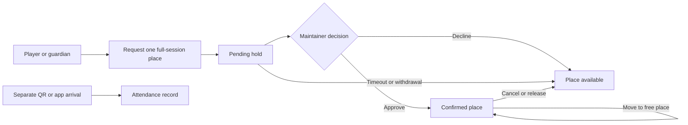

# Implementation and deployment status

Updated 7 November 2026. Requirements describe the target product; this file and `tasks.md` describe what exists. A schema or synthetic screen does not complete a production feature.

## Supabase handover: office laptop blocked

The owner confirms that Supabase database connections are blocked from their office laptop. The observed CLI failure is a timeout connecting to the hosted PostgreSQL pooler while initializing a temporary login role. This is an environment/connectivity blocker, not evidence that the project, frontend build or migration SQL is defective. No firewall bypass or office-network change is part of this work.

The hosted project already exists: organization **TT Clubs Ireland**, project **ttclubs**, reference **mkxqrkqwpvjtkjfjjckm**, region **eu-north-1 (Stockholm)**. Hosted migration application and further connection setup remain paused. The owner will complete the connection setup from their personal laptop after repository updates are available. Never record database passwords, access tokens or service-role keys in OpenSpec, source code or build output.

Supabase is the proposed shared authentication, PostgreSQL and authorization service. It is needed for verified player/parent accounts, guardian relationships, current club permissions, persistent memberships, attendance, shared table availability, concurrent booking protection, match/tournament records and notification scheduling. Email transport also requires a configured delivery provider; creating Supabase alone does not send the application's reminders.

Cloudflare serves the website/app frontend assets independently. Local development, synthetic UI flows, pure domain rules, automated tests, builds and documentation can proceed without a hosted database. Browser-local bookings do not synchronize devices or provide server-side access control. The existing QR RPC code also requires migrations, authenticated profiles and permitted roles before live use.

### Personal-laptop handover sequence

1. Pull the latest `main`, select Node 22 and install dependencies with `npm ci`. Use synthetic test records only.
2. Sign into the Supabase CLI with the owner's account and link project `mkxqrkqwpvjtkjfjjckm`. Do not create a duplicate project or reset the hosted database.
3. From a permitted personal connection, run `npx supabase db push --remote --dry-run`. The previously installed CLI requires `--remote` to target the linked project. Check `--help` if the installed CLI changes; never assume a local reset command is safe for hosted use.
4. Review the proposed migration list and database/schema state before running `npx supabase db push --remote`. Apply repository migrations only; `supabase/tests/plain_postgres_auth_fixture.sql` is a local CI fixture, not a hosted migration. If the pooler still times out, stop and diagnose connectivity separately rather than retrying writes blindly.
5. Configure environment variables privately, exact Auth site/redirect URLs, and synthetic users, profiles, club permissions and guardian relationships. The earlier local frontend configuration may not exist on the personal laptop.
6. Report the dry-run/application outcome without credentials. Completing this handover does not itself finish registration, role management, production booking, email, backup or acceptance work. Continue the pending implementation tasks and verify access isolation before importing real member/child records.

## Capability reconciliation

| Capability | Repository delivery | Remaining implementation / live acceptance |
| --- | --- | --- |
| Identity and access | Domain relationships, club-context helpers, schema and partial existing-user QR sign-in | Registration/recovery, account linking, real guardian flows and complete runtime authorization |
| Club content | Leeside sections for About/coaching, saved fee snapshot, contact/mail enquiry, source news/calendar/policy links; supplied booking HTML received | Full Wix media/documents/news/calendar import, content reconciliation and real publishing workflows |
| Membership management | Domain rules and schema | Editable products, manual assignment/renewal/payment UI, trials and production permissions |
| Booking management | Shared interactive player-place preview in both frontends; pure rules and tests | Transactional player-place database model/RPCs, real authentication, shared availability, hall/schedule editor and server audits |
| Member communications | Outbox schema; booking notification simulation clearly labelled | Email provider, authenticated sender, delivery worker, expiry/trial schedules and preferences |
| Attendance tracking | Venue QR preview/display and confirmation RPC source | Hosted acceptance, direct app presence, Not attending, reporting and expired/no-membership alerts |
| Match records | Schema foundation | Scoring screens, review/dispute flow, five-day job and statistics |
| Tournament management | Schema foundation | Internal league/bracket operation, delegated organizers, doubles/guests and session roster flow |
| Tournament reflections | Detailed requirements | External event entry, private skill tags, provenance and coach aggregates |
| Player development | Schema foundation | Published summaries/goals, restricted coach notes and sign-off |
| Club administration | Domain roles, schema and dashboard demonstration | Runtime group grants/revocation, work queues, policy editing and complete permission tests |

## Session booking preview delivered

In the current preview these are browser-local transitions. Production must enforce them transactionally on the backend, with independent attendance evidence and notifications.

The supplied `Leeside Table Booking.html` is a design reference. Its Claude-specific runtime APIs are not dependencies of the React app. `packages/ui/src/SessionBookingDemo.tsx` is reused by the Leeside website and the Leeside section of the platform demo. `packages/domain/src/session-booking.ts` contains tested prototype rules.

The approved unit is **one player place for a whole session**, with **four places per table** and **one active pending/confirmed place per player per session**. Parents can request separate places for linked children. Preview roles support request, approve/decline, cancellation, staff moves/releases and per-session reservable/coaching/walk-in/closed allocations. Attendance remains independent. Staff can explicitly release a no-show's place; no automatic no-show detection is claimed.

The preview uses synthetic people and browser-local storage, including simulated confirmation messages. Its twelve tables, initial six coaching tables, thirty-minute hold and two-hour cancellation cutoff are demonstration defaults, not confirmed physical inventory or a completed admin policy editor. Production values remain configurable requirements. The earlier hourly whole-table model is superseded. The historical `bookings` schema alone does not implement the new inventory constraints.

## Release gates and deferred scope

Code delivery `ef10b50` is pushed to main. The website deployment was verified using matching JS/CSS hashes, SPA response and a live mobile synthetic request/approval walkthrough. Local checks passed 21 tests, all workspace type checks, both builds and OpenSpec validation. See `docs/CLOUDFLARE_DEPLOYMENT_PLAN.md` for asset evidence. This verifies the preview, not the remaining live product.

Hosted setup is one dependency, not the only remaining work. Production requires tested RLS/permissions, shared transactional services, authenticated email delivery, backups/restoration, safeguarding/privacy configuration and end-to-end acceptance. Do not advertise real bookings or import private live records into a synthetic demo.

For another coding agent, root `AGENTS.md` provides the required reading order, approved decisions, code locations, ordered implementation streams, test/deployment commands and reporting rules. It links this status record rather than maintaining an unrelated competing task list. Public website copy identifies the preview; infrastructure credentials and developer task details belong in repository documentation, not visitor account flows.

NFC hardware purchases and broad pilot recruitment stay parked. Native iOS/Android store releases follow the PWA pilot. Website repository extraction is reviewed only after at least one live year and three or more clubs. See `tasks.md` for the full outstanding implementation checklist and `docs/ACCOUNT_SETUP_README.md` for owner account actions.
